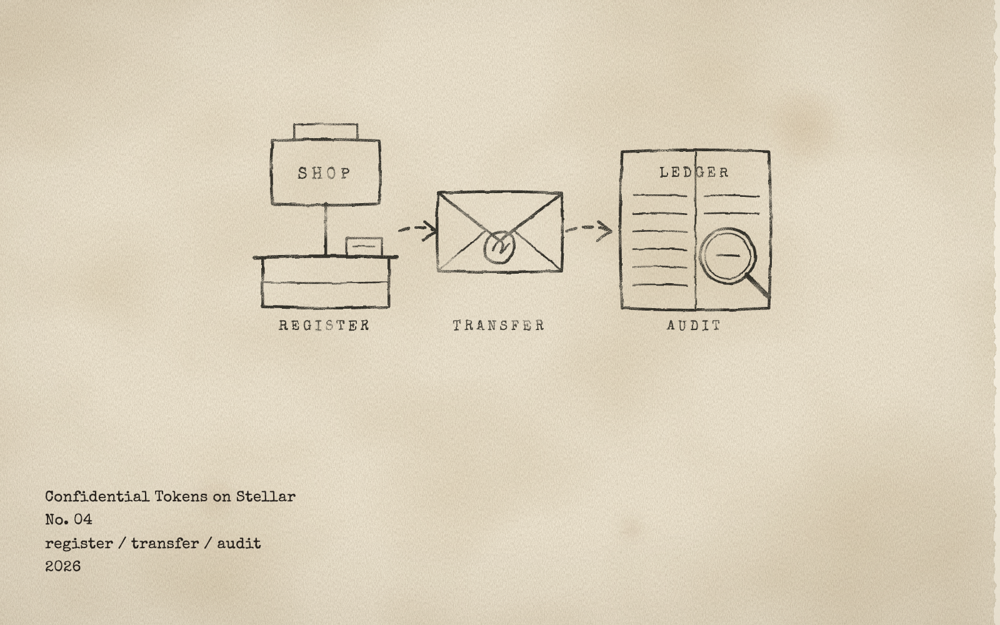

# Field Note No. 04: Confidential Tokens on Stellar

*register / transfer / audit. 2026.*



## Attribution

- **Built by:** Bri Wylde, Developer Relations at the Stellar Development Foundation, GitHub [briwylde08](https://github.com/briwylde08), built the game. Kaan Kacar, Developer Relations at the Stellar Development Foundation, GitHub [kaankacar](https://github.com/kaankacar), ran the stable release and wrote the runbook. Sections 1, 2a, 3 and the gotchas in 4 are Bri's words. Section 2b and the rest of 4 are Kaan's.
- **Release:** Confidential Tokens on Stellar by OpenZeppelin. Developer Preview on 29 June 2026 ([the blog post](https://stellar.org/blog/developers/developer-preview-confidential-tokens-on-stellar), [the stream](https://www.youtube.com/watch?v=FxOz4jo3QIE)) and the stable release in `stellar-contracts` [v0.8.0](https://github.com/OpenZeppelin/stellar-contracts/releases/tag/v0.8.0) on 20 October 2026 as the crate [`stellar-confidential` 0.8.0](https://crates.io/crates/stellar-confidential/0.8.0), with [OpenZeppelin's docs page](https://docs.openzeppelin.com/stellar-contracts/tokens/confidential/confidential), [the audit report](https://github.com/OpenZeppelin/stellar-contracts/blob/v0.8.0/audits/Stellar%20Contracts%20Library%20v0.8.0%20Audit.pdf) and [the privacy page](https://developers.stellar.org/docs/build/apps/privacy) in the Stellar docs.
- **Demo:** the game, [Who Ate Gerald?](https://gerald.stellar.buzz) (Freighter on testnet), source at [github.com/briwylde08/who-ate-gerald](https://github.com/briwylde08/who-ate-gerald). The runbook walkthrough video `DR-6_confidential-tokens-field-note_2026-11-23.mp4` and the screenshots `DR-6_confidential-tokens-field-note_00` to `09` in the Drive folder [`Demos + Field Notes/Confidential Tokens`](https://drive.google.com/drive/folders/1MJVqev8MqAAEtoPkLrEvElxQAScXhak8). Runbook code: [github.com/kaankacar/stellar-confidential-token-runbook](https://github.com/kaankacar/stellar-confidential-token-runbook), MIT.
- **Repos used:** OpenZeppelin's [`packages/confidential`](https://github.com/OpenZeppelin/stellar-contracts/tree/v0.8.0/packages/confidential) at v0.8.0 (`soroban-sdk` 28.0.0). The client SDK [`stellar-confidential-token-sdk`](https://github.com/brozorec/stellar-confidential-token-sdk) 0.3.0 at commit `aad1706` (`@aztec/bb.js` 0.87.0, `@noir-lang/noir_js` 1.0.0-beta.11, circuits and verification keys bundled). The [demo repo](https://github.com/brozorec/stellar-confidential-token-demo) at `626d00f` for its public testnet deployment and its deploy script. Nethermind's [`ultrahonk-soroban-verifier`](https://github.com/NethermindEth/rs-soroban-ultrahonk) 0.1.0 on chain. Stellar CLI 30.0.1 for the contract build, `@stellar/stellar-sdk` 14.6.1, Node 24. The game runs on the July 2026 preview deployment with the SDK vendored at `b3da4fe`; the runbook runs on 0.8.0. Neither of us is affiliated with OpenZeppelin.

## 1. What we built

**Bri.** Who Ate Gerald? is an eight-player social deduction game in which confidential token transfers serve as clues. Players make private purchases, investigate each other's spending, accuse their neighbors, and try to identify the werebear before the village population gets wiped out.

To begin, players log in to Freighter, choose a character, and are secretly assigned as either a villager or a werebear. During the day, each player shops for items at four stores. Items can protect you, expose other players, or just create chaos. You can even buy Gerald's fingers. Gerald, unfortunately, was the first villager eaten by the werebear. That is how everyone knows there is a werebear in their midst.

Every purchase is a real testnet XLM transfer through a confidential token contract. The blockchain shows that a player paid a particular shop, but not how much they spent or which item they bought. Every price in the game is unique, so the amount is the item. Once everyone is finished shopping, each player can ask Maude McLedger, the contract's auditor, one question about other players' purchases. Then the accusations begin. Every night one player is banished by the village, and one player is eaten by the werebear.

Under the hood, the game uses every major step of the confidential token lifecycle: registration, deposits, merges, transfers, withdrawals, and auditor access. One piece of context before I get into how all of that works: I'm a vibe coder. I wasn't a developer before Claude and other AI models entered our lives, and I relied heavily on AI to build this game. The problem is that Claude could confidently tell me it had built a working confidential token transfer flow, but I had no way to know whether that was actually true until I understood the flow myself. So I started digging into what the game was doing under the hood, and that process is how this note came to exist.

**Kaan.** The game was built in July 2026 on the developer preview. OpenZeppelin shipped the stable release on 20 October. The brief for this note was one sentence: reframe Bri's draft into a Field Note and attach the demo. I added one thing. I ran the six steps myself on the stable release, on testnet, with a script that logs every transaction, every proof and every fee. Twice: once against the public 0.8.0 deployment the demo repo uses, once against a deployment I made from the same code. Everything here runs on testnet. There is no confidential token on mainnet yet. It took one evening on 23 November for the runs and a day for the write-up.

## 2. How it went

### 2a. The game in the wild

**Bri.** The game has been live since the summer. In that time the Blacksmith alone received 320 confidential payments. Three things taught me the most.

Before I automated the merges, the Blacksmith's explorer page showed only three transactions despite hundreds of incoming payments. My first thought was that the system had simply broken. Here is the thing about confidential transfers: the sender handles everything. They submit and authorize the transaction, while the recipient doesn't have to sign anything. An account page lists only transactions where that account is the source or a signer. A recipient named only as a contract-call argument never appears. Activity only surfaces when the recipient steps in to merge or withdraw.

My shops are automated service accounts. They sat for a month accumulating tokens because I hadn't written the code to make them merge. By the time I fixed it, they had gathered 19,500 XLM that were totally unspendable. Nothing was lost, but the shops' public pages remained empty, hiding the wealth they had technically received. Now every morning the game server signs merges for the shops. No proof is needed for that.

Generating proofs is resource-heavy. It works fine in a browser or a Node.js script, but it is a non-starter for 128 MB serverless workers. That divide decided where my game logic lives. Players generate proofs for their own transfers client-side, in the browser. Withdrawals need proofs too, so they stay outside the main game loop in a script I trigger by hand.

### 2b. The six steps on v0.8.0

**Kaan.** Four runs on 23 November, all on testnet by friendbot. The logs with timestamps and transaction links are in `docs/field-note/runs/`. Only the numbers that carry a finding are here.

**Run 0, recon.** `pnpm recon`. Read before you touch. The public 0.8.0 token and Bri's preview token expose the same eleven functions; the difference is the Soroban SDK underneath, 28.0.0 against 26.1.0. The verifier registry holds one verification key per circuit. The SDK bundles the same six keys with a manifest of SHA-256 hashes, but nothing in the SDK checks the two against each other before it proves; the README lists that as a known gap. So recon does the check by hand: six of six matched. Then the retention window. The testnet RPC serves about 7.7 days of events. The public deployment is a month old, 393,630 ledgers outside the window. That matters in run 2. (Screen 01.)

**Run 1, my own deployment.** The demo repo builds the contracts with `stellar contract build` and deploys verifier, auditor registry, token and factory with one script. It needs Stellar CLI 28.1.0 or newer; mine was 26.0.0, so I ran the 30.0.1 release binary from a folder without replacing it. Seven wasms in 1 min 12 s, the deployment in 1 min 35 s. The script hardcodes the deployer identity name `admin`; I patched it to read an environment variable. (Screen 07.)

**Run 2, the lifecycle.** `pnpm lifecycle`. Two fresh accounts, Alice and Bob. The demo's end-to-end script derives the confidential keys from a random scalar, which no one can recover. Registration is single-use per account, so a lost key is a dead account. The SDK ships the recoverable path, a SEP-53 signature by the account's own key over a fixed message, so I used that and derived twice to prove it is deterministic. Then: register Alice, register Bob, deposit 100 XLM, merge, transfer 42.5 XLM to Bob, Bob merges, Bob withdraws 10 XLM. Seven transactions in 53.5 s. Every proof took under 0.8 s in Node and is 14,592 bytes. Bob's receiving balance came out as 42.5 XLM by decrypting the transfer event with his viewing key; the chain holds only a commitment. (Screens 02 and 04.)

The one surprise was the first fee. Alice's registration cost 2.77 XLM. Bob's, one ledger later, cost 0.015 XLM. The transaction meta explains it: Alice's call restored eight archived ledger entries. The verification keys, the auditor key and the token instance had passed their TTL a month after deployment. Protocol 23 restores archived entries inside the call that touches them, so the SDK did nothing special and the fee simply arrived in the simulation. On my own fresh deployment the same registration cost 0.021 XLM. Budget for the first touch of an old testnet deployment, or extend the TTLs. (Screen 03.)

The second finding is the one recon predicted. The demo's script starts every state engine at the deployment ledger. On the month-old deployment the RPC refuses that with "startLedger must be within the ledger range", and the SDK rethrows the raw JSON-RPC object, which prints as `[object Object]`. My script starts each engine at the ledger the account registered in. The game's vendored SDK carries a local patch for the same problem.

**Run 3, the auditor and the explorer.** `pnpm auditor`. The transfer event has twelve fields: `from`, `to`, an ephemeral point and nine field elements. No `amount`. With the demo auditor's secret, which the demo publishes on purpose, `auditTransfer` returned 42.5 XLM and Alice's balance after the transfer, 57.5 XLM, in 11 ms, with both auditor channels agreeing. A random key returned noise. `auditWithdraw` returned Bob's balance after the withdraw, 32.5 XLM. Then Horizon: Bob's account lists four transactions, and the one that paid him 42.5 XLM is not among them. Bri's empty explorer page, reproduced on the stable release. (Screens 05 and 06.)

Then I repeated runs 0, 2 and 3 on my own deployment. Same results, 0.107 XLM in fees for all seven transactions, no restored entries.

## 3. The mental model that made it click

**Bri.** There are three places value lives.

Your regular balance is real XLM held by your Stellar account, the amount in your Freighter wallet. It is public.

The contract pool: the confidential token contract acts as a wrapper around regular XLM. It holds all deposited XLM in one shared pool. The pool's total balance is public, but its internal ownership breakdown is not. You can wrap any SEP-41 asset; the game uses XLM.

Your confidential claims: the contract keeps an internal ledger entry for every registered participant. Your entry contains your public keys, your auditor configuration, a pending balance and a spendable balance. The balance fields do not contain readable numbers. Each is stored as a Pedersen commitment: a balance combined with a large random secret, represented as a point on an elliptic curve. Anyone can read the commitment bytes on chain, but those bytes do not reveal the balance. Only someone with the opening, the original amount and its random secret, can interpret the commitment. Your device must therefore track the information needed to open and update your commitments.

**Pending is your inbox. Spendable is your pocket.** Deposits and incoming transfers land in pending. Other participants can increase it by paying you, but they cannot spend from it. You cannot spend from pending either. You must first merge the entire pending balance into spendable, all or nothing. Transfers and withdrawals come from spendable, and only actions you authorize can change it.

Why the split? A zero-knowledge proof is only valid against the exact commitment that existed when the proof was created. If incoming transfers went straight into your spendable balance, you could start constructing a payment proof, receive a tiny payment from someone else before submitting it, and suddenly your balance commitment has changed, making your proof invalid. Someone could do that on purpose, forever. The pending balance absorbs the changes caused by the outside world. Your spendable balance stays stable and only changes when you act.

A first confidential payment touches all six steps. Register, once per participant per wrapper contract, with a small proof; it binds your keys and your auditor and creates both commitments at zero. Deposit, public XLM into the pool, amount visible to everyone; think of it as an exchange, the XLM stays XLM and what becomes confidential is the claim on it. Merge, pending into spendable. Transfer, a proof that you had enough, that your balance went down by the amount and the receiver's pending went up by the same amount, and that nothing was created or destroyed; the amount stays hidden, the parties and the time do not. Merge again, on the receiver's side, at a time of their choosing. Withdraw, part of the claim back to regular XLM, amount public again.

The auditor is an encryption keypair, not a Stellar account. Its public key sits in an on-chain registry, and when an account registers it picks which entry audits it. That choice is permanent. Every transfer the account sends or receives must include its amount encrypted to that auditor's key, and the circuit rejects a transfer without valid auditor copies. Whoever holds the matching secret can open every amount for the accounts bound to it. Gerald's registry has one entry, so Maude McLedger audits every villager and every shop.

**Kaan, one line.** The code and the docs call the inbox the `receiving` balance; Bri's "pending" is the same thing.

## 4. Friction log

The log is [friction-log.md](https://github.com/kaankacar/stellar-confidential-token-runbook/blob/main/docs/field-note/friction-log.md): 10 rows, only the problems that change a developer's experience and that OpenZeppelin can act on. The long list, our own mistakes included, is [friction-log-full.md](https://github.com/kaankacar/stellar-confidential-token-runbook/blob/main/docs/field-note/friction-log-full.md).

**Bri's gotchas, in her words.** Registration locks a confidential key hierarchy to a specific account, and your application has to recreate those exact keys every time the user returns. Gerald derives them from a deterministic wallet signature over a fixed message. Things got messy when I looked into passkeys. WebAuthn assertions aren't naturally stable for key derivation because they use random challenges, and the PRF extension's support is spotty. And on Stellar a passkey wallet is usually a new contract account, so moving a user to one makes them a new participant; their old balance won't follow them without a public withdrawal and deposit. (O9.) The other two are above: the proof memory that rules out small workers (O8), and service accounts that never merge by themselves (full log, by design).

**What we would ask OpenZeppelin to fix, in order:**

1. Publish the SDK, or reserve the name. Today it is a git dependency from a personal repo, and `npm install stellar-confidential-token-sdk` installs an unrelated project. (O1.)
2. Make the end-to-end example derive keys the recoverable way. It ships the SEP-53 derivation and then uses a random scalar. (O2.)
3. Clamp `fetchEvents` to the RPC window and wrap RPC errors in an `Error`. The example's `fromLedger: deployedAtLedger` stops working a week after deployment. (O3.)
4. Check the on-chain verification keys against the bundle before the first proof. It is a declared gap and a one-call fix. (O4.)
5. Say somewhere that a dormant deployment costs XLM to wake, and that a vanilla token has no admin to extend TTLs. (O5.)
6. One name for the inbox balance across the blog, the docs and the code. (O7.)
7. Update the docs page and the demo README: the demo is on 0.8.0 now, and the verifier and circuits are in the audit. (O6, O10.)

## 5. Where we think this goes

**Bri.** Games may not be what this feature was built for, but the mechanics apply directly to more serious applications. Every pattern in Gerald, a public pool with private claims, an inbox that absorbs the outside world, an auditor who sees everything and answers little, is a payroll, a supplier payment or a treasury move with the names changed.

**Kaan.** The stable release is the real start. Issuers get the compliance extension in the same crate: freezing, an authorization policy, clawback. OpenZeppelin has a designated-auditor and approval-gate profile for real-world assets open as [PR #976](https://github.com/OpenZeppelin/stellar-contracts/pull/976), and Boyan Barakov's [issuer-controlled confidential stablecoin](https://stellar.org/blog/developers/practical-confidential-stablecoins-an-issuer-controlled-architecture) post is the design to read first. Two things to watch before mainnet: the verifier accepts only the non-zero-knowledge UltraHonk flavour today, so OpenZeppelin does not yet guarantee that the proofs themselves keep amounts private, and Nethermind's zero-knowledge verifier is [PR #38](https://github.com/NethermindEth/rs-soroban-ultrahonk/pull/38), still open. And the wallet side: a client has to keep openings it can only read from a seven-day event window, or run an indexer. The first wallet that does both well will set the pattern.

## 6. Try it yourself

Play the game at [gerald.stellar.buzz](https://gerald.stellar.buzz) with Freighter set to testnet, and read [its source](https://github.com/briwylde08/who-ate-gerald). It is published as a reference example, not a template.

Run the six steps on the stable release:

```bash
git clone https://github.com/kaankacar/stellar-confidential-token-runbook && cd stellar-confidential-token-runbook
pnpm install                    # Node 22+, pnpm 10 or 11; the SDK compiles on install
cp .env.example .env            # leave the keys empty: friendbot creates throwaway ones
pnpm recon -- --log runs/run0.log       # read-only: keys, window, interfaces
pnpm lifecycle -- --log runs/run2.log   # seven transactions on the public 0.8.0 deployment
pnpm auditor -- --log runs/run3.log     # decrypt the transfer, check Bob's empty page
```

Set `AUDITOR_SECRET_HEX` in `.env` to the demo auditor's secret from `packages/app/lib/deployment.ts` of the [demo repo](https://github.com/brozorec/stellar-confidential-token-demo) before `pnpm auditor`. To deploy your own token, follow the demo repo's `pnpm build:contracts` and `pnpm deploy:contracts` with Stellar CLI 28.1.0 or newer, then put the four contract ids in `config/deployment.own.json` and add `--deployment own`.

Read [OpenZeppelin's docs](https://docs.openzeppelin.com/stellar-contracts/tokens/confidential/confidential), the [protocol docs in the repo](https://github.com/OpenZeppelin/stellar-contracts/tree/v0.8.0/packages/confidential/docs) and the [privacy page](https://developers.stellar.org/docs/build/apps/privacy). Bring questions to the next Stellar Developers Meeting.
